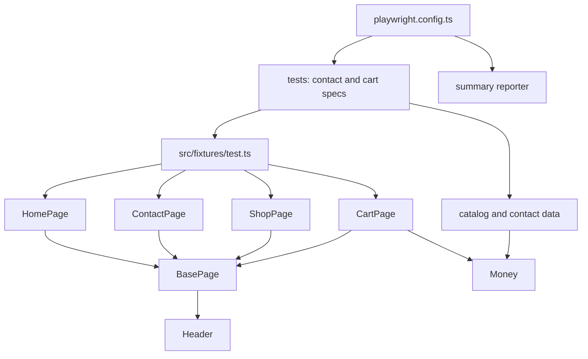
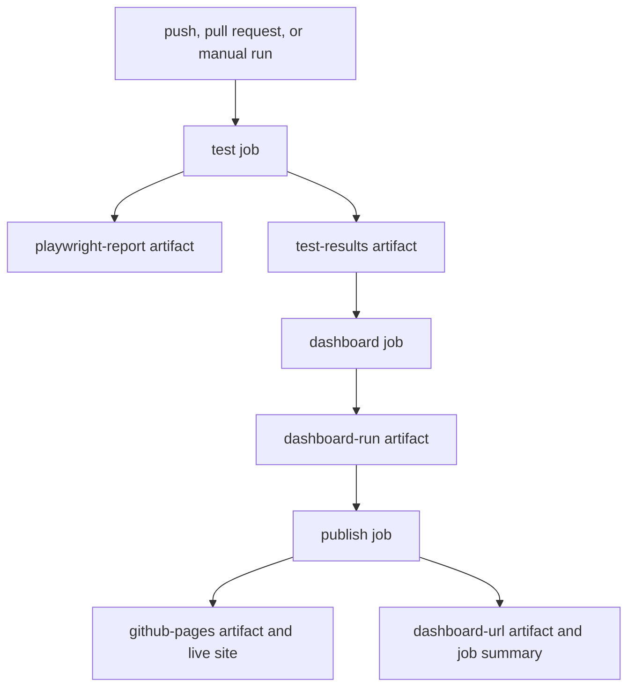

# jupiter-toys-ui-regression

UI regression pack for [Jupiter Toys](https://jupiter.cloud.planittesting.com). Playwright and TypeScript drive three cases: contact-field validation, a successful contact submission, and cart price totals.

## Dashboard

Run history: https://ashishraj-tyagi.github.io/jupiter-toys-ui-regression/

Times on the dashboard are shown in AEST (UTC+10). Each workflow run also prints the address in the job summary and uploads it as the `dashboard-url` artifact.

## Framework

Specs stay in the order of the cases. Page objects own locators and actions. Prices are compared in integer cents so totals do not drift.



| Piece | Role |
| --- | --- |
| `tests/contact/mandatory-fields.spec.ts` | Submit an empty contact form, check the errors, then clear them. |
| `tests/contact/successful-submission.spec.ts` | Submit a valid form and wait for the thank-you message. |
| `tests/shop/cart-totals.spec.ts` | Buy 2 Stuffed Frog, 5 Fluffy Bunny, and 3 Valentine Bear, then check each price, each subtotal, and the cart total. |
| `src/fixtures/test.ts` | Injects `home`, `contact`, `shop`, and `cart` into each spec. |
| `src/pages` | `HomePage`, `ContactPage`, `ShopPage`, and `CartPage` extend `BasePage`. |
| `src/components/Header.ts` | Opens Home, Shop, Contact, and Cart, and reads the cart count. |
| `src/domain/Money.ts` | Parses `$10.99` and unformatted totals such as `116.9`, and adds or multiplies in cents. |
| `src/data` | Product prices and one valid contact payload. |
| `src/reporters/summary-reporter.ts` | Writes `test-results/summary.json` after the run. |

## Test execution

The pack runs on GitHub-hosted `ubuntu-latest` with Node.js 22. A pull request runs the tests and records a summary. A push to `main` or `feature/**`, and a manual run, also publish the dashboard.



| Artifact | What it contains |
| --- | --- |
| `playwright-report` | HTML report for this run. Open it from the artifact, or locally with `npm run report` after a local run. |
| `test-results` | Failure screenshots, retry traces, and `summary.json`. |
| `dashboard-run` | One JSON record: run id, commit, branch, result, and the test summary. |
| `github-pages` | Static dashboard site uploaded for GitHub Pages. Produced on push and manual runs, not on pull requests. |
| `dashboard-url` | A text file with the dashboard address. The same address is written to the job summary. |

The `publish` job is skipped for pull requests. Pull requests still upload `playwright-report`, `test-results`, and `dashboard-run`.

## Setup

Install Node.js 22, then install the dependencies and Chromium:

```bash
npm ci
npx playwright install --with-deps chromium
```

On macOS, `npx playwright install chromium` is enough. `--with-deps` installs the system libraries the Linux runner needs.

## Run the tests

### On your machine

```bash
npm test
```

Other local commands:

```bash
npm run test:headed
npm run report
```

`npm test` runs headless Chromium against `https://jupiter.cloud.planittesting.com`. A retry is not used locally. Traces are kept on the first retry, and a screenshot is kept when a test fails. The HTML report is written to `playwright-report/`, and `test-results/summary.json` is written beside any traces.

### On a GitHub Actions runner

The workflow file is `.github/workflows/ui-regression.yml`. It starts when:

- a commit is pushed to `main` or a branch named `feature/**`
- a pull request is opened or updated
- someone starts **UI regression** from the Actions tab with **Run workflow**

You do not start a runner by hand. GitHub provides `ubuntu-latest`. The test job checks out the repository, installs Node.js 22, runs `npm ci`, installs Chromium, and runs `npx playwright test`. One retry is enabled when `CI` is set.

After the run, open the workflow run in the Actions tab. Download the artifacts listed above, and use the job summary link or the `dashboard-url` artifact to open the dashboard.
